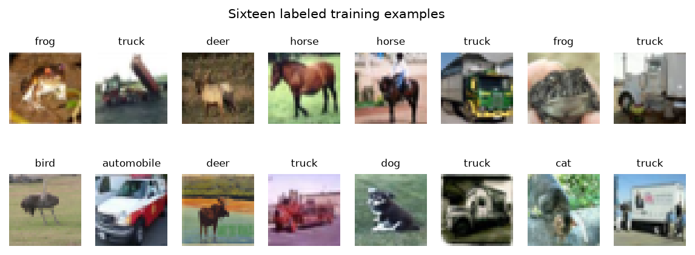
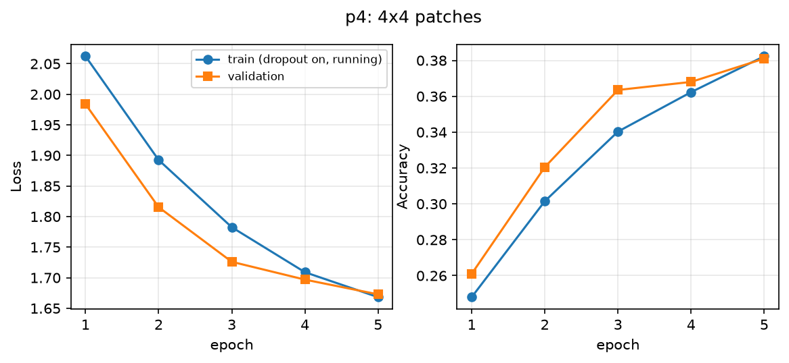
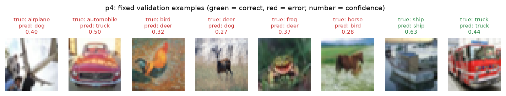
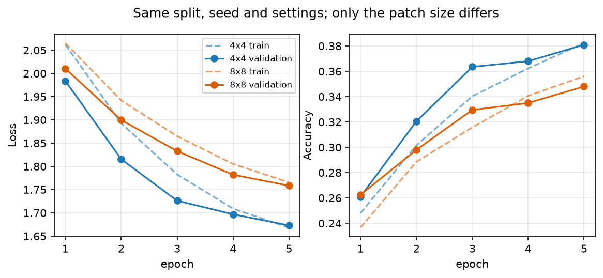
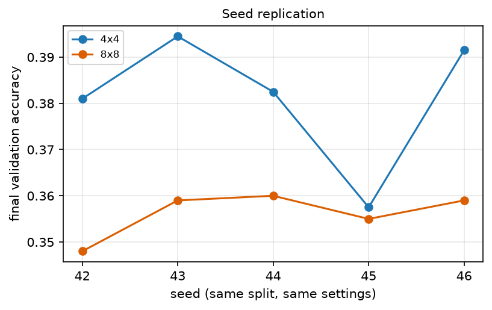
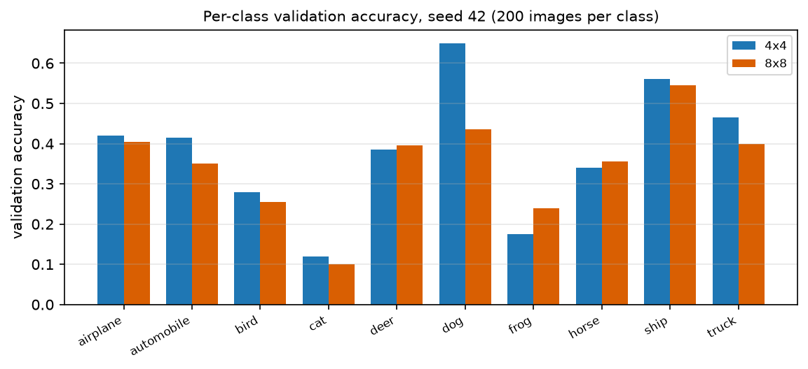
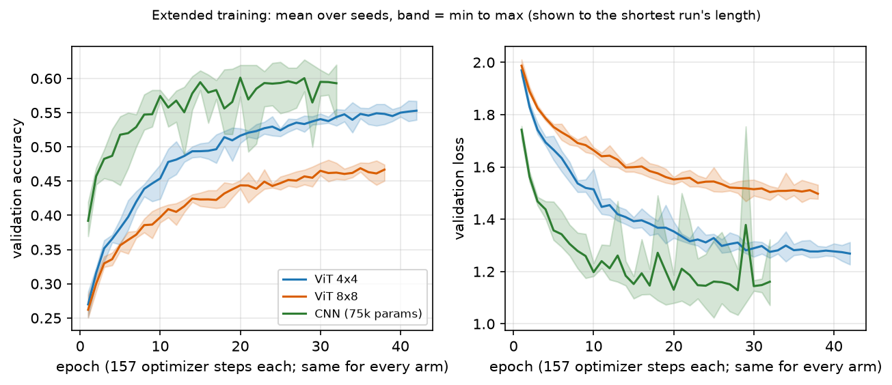

# Patch Size in a Small Vision Transformer

**Samuel Collins** - Ph.D. Student, Department of Cyber-Physical Systems, Clark Atlanta University
samuel.collins@students.cau.edu

Computer Vision - Lab Assignment 6: Vision Transformers (ViT)

Instructor: Dr. Kishor Datta Gupta

Date: 2026-10-16

Repository: https://github.com/srcollins785/Samuel_Collins_ViT_Patch_Size

---

## Summary

**Smaller patches won here, by a modest margin at five epochs, and not by being cheaper.** The 4x4 model reached 38.1% validation accuracy against 34.8% for 8x8 (a gap of 3.3 points), and it was ahead in 5 of 5 seeds, by 2.5 points on average (range 0.3 to 3.6). The 4x4 model computes 14.6 times as many attention-score entries per head and layer, yet its measured training time was 4.1 s against 4.7 s: at this scale the cost is not set by the attention map. Absolute accuracy is low for both (below 40 percent), as expected of a tiny ViT trained from scratch for five epochs. Supplementary runs to convergence (section 4.6) show the gap widening rather than closing: 10.1 points at the stopped epoch, ahead in 5 of 5 seeds, with a parameter-matched CNN ahead of both (63.2% against 57.1% and 47.0%).

A two-block ViT (width 64, four heads, feed-forward width 128) was trained from scratch on a stratified 10,000-image subset of CIFAR-10 with 2,000 separate validation images, for 5 epochs, once with 4x4 patches and once with 8x8 patches. The split, seed, preprocessing, optimizer, batch size, epoch budget and every width, depth and head count were identical; only the patch size differed. The official test split was never loaded. Total training time was 8.8 s on Apple M4 Max (mps).

Every table, figure and number in this report was generated from the saved run files by `scripts/generate_report.py`; none was typed by hand. `scripts/validate_results.py` audits those files, including that the two run configurations differ in the patch size and in no other field.

## 1. Data and configuration

The images are not in the repository (the brief forbids submitting dataset downloads). `scripts/build_cifar_split.py` rebuilds the same split from the committed indices, and both runs recorded the same checksum, which the audit checks. All settings below are identical for the two runs except the patch size.

| Item | Value |
|---|---|
| Dataset | CIFAR-10 official training split (50,000 images), native 32 x 32 RGB |
| Training subset | 10,000 images, 1,000 per class |
| Validation subset | 2,000 images, 200 per class, disjoint from training |
| Test split | never loaded; kept out of model selection |
| Seed | 42 |
| Split checksum | `0a7a9f92ecec1aac...` (SHA-256 over both index lists) |
| Split indices | `data/split_indices.json` (committed) |
| Normalization | per-channel mean [0.4915, 0.4817, 0.4465], std [0.248, 0.2447, 0.2626], from the training subset only |
| Augmentation | none |
| Optimizer | Adam, learning rate 0.0003, betas (0.9, 0.999), no weight decay |
| Batch size | 64 (157 batches per epoch) |
| Epochs | 5 |
| Dropout | 0.1 in attention, MLP and embeddings; off at evaluation |
| Loss | `CrossEntropyLoss` on raw logits (log-softmax is inside the loss; no second softmax) |
| Hardware | Apple M4 Max, device `mps`, macOS-26.6.2-arm64-arm-64bit |
| Libraries | Python 3.12.13, torch 2.14.0, torchvision 0.29.0, numpy 2.5.3 |



*Sixteen labeled training examples.*


## 2. The model

The model follows Dosovitskiy et al. (2021) at the sizes the brief fixes: non-overlapping patches, one shared linear projection to width 64, a learnable class token, learned position embeddings, two pre-norm encoder blocks (LayerNorm, four-head self-attention, residual; LayerNorm, MLP of width 128 with GELU, residual), a final LayerNorm and a linear head to 10 logits. The encoder is written out by hand (`src/vit_patch_size/model.py`) so the attention weights are available; `tests/test_model.py` checks it against `nn.MultiheadAttention` with identical weights, so it is verified, not trusted.

### 2.1 Tensor shapes

Shapes below were recorded from a real forward pass, not derived from constructor arguments. B is the batch size.

| Stage | 4x4 patches | 8x8 patches |
|---|---|---|
| Images | (B, 3, 32, 32) | (B, 3, 32, 32) |
| Flattened non-overlapping patches | (B, 64, 48) | (B, 16, 192) |
| Projected tokens (shared linear layer) | (B, 64, 64) | (B, 16, 64) |
| With class token | (B, 65, 64) | (B, 17, 64) |
| With position embedding | (B, 65, 64) | (B, 17, 64) |
| Encoder output (2 blocks) | (B, 65, 64) | (B, 17, 64) |
| Class-token representation | (B, 64) | (B, 64) |
| Logits | (B, 10) | (B, 10) |

With P x P patches on a 32 x 32 image, the number of patch tokens is N = (32/P)^2 and the total including the class token is L = N + 1. For P = 4, N = (32/4)^2 = 64 and L = 65. For P = 8, N = (32/8)^2 = 16 and L = 17. Each flattened patch has 3 x P x P values: 48 for 4x4 and 192 for 8x8.

### 2.2 Queries, keys and values

Each token t is multiplied by three learned matrices to give a query q = W_Q t, a key k = W_K t and a value v = W_V t. The query and key decide *where to look*: the score of token i for token j is the dot product q_i . k_j, a similarity (large when the two vectors point the same way). Scores are divided by the square root of the key dimension, for stable gradients, and passed through a softmax along j, giving non-negative weights that sum to 1. The value decides *what is passed on*: the output for token i is the weight-weighted sum of every token's value vector. Four heads repeat this in four 16-dimensional subspaces and an output projection mixes the results (lecture L2, slides 21-35).

**A worked example with three value vectors** (the values and the scores [2, 4, 4] for query 1 are the lecture L1 example):

|  | weights | weighted sum of v1=[0,0,0], v2=[1,4,0], v3=[1,3,1.5] |
|---|---|---|
| softmax of raw scores | [0.063, 0.468, 0.468] | [0.937, 3.278, 0.702] |
| softmax of scores / sqrt(3) (what the model does) | [0.136, 0.432, 0.432] | [0.864, 3.024, 0.648] |

The lecture slide rounds the softmax to [0.0, 0.5, 0.5], which gives [2.0, 7.0, 1.5]; the exact values are above. Token 1 gets almost no weight because its key matches the query worst, so the output is nearly an even blend of v2 and v3. The slide's last summary row reads [2.0, 7.0, 1.0] where its own step gives 1.5, so this report does not reuse that row. `tests/test_model.py` asserts these exact numbers.

### 2.3 Why positions are needed, and why there is no causal mask

Self-attention is permutation-equivariant: the weights depend only on token content, so without extra information the patches are an unordered set and a shuffled image looks the same as the original. The learned position embedding, added to each token, is what tells the model where a patch came from. This is tested rather than assumed: with the embedding zeroed, shuffling an image's patches leaves the logits unchanged, and with a non-zero embedding it does not (`test_position_embedding_breaks_permutation_symmetry`).

Image classification has no left-to-right generation order, so nothing should be hidden: every patch may attend to every patch, in both directions. A causal mask (future positions set to minus infinity before the softmax) belongs to the transformer *decoder* (lecture L2, decoder slide); the ViT uses only the encoder. With a causal mask the class token, at position 0, could attend to nothing but itself. `tests/test_model.py` checks that attention above the diagonal is non-zero and that changing only the last patch changes the class output.

## 3. The 4x4 model: training and evidence

Trained from scratch for 5 epochs with the brief's starting configuration (Adam, learning rate 3e-4, batch size 64), unchanged. Validation ran with dropout disabled (`model.eval()`) and no gradient updates (`torch.no_grad()`); a test checks that evaluation changes no parameter.

**Final validation accuracy 38.1%**, validation loss 1.6728, **75,082 parameters**, **training runtime 4.1 s** (training and validation, 5 epochs, mps). Chance is 10%.

| epoch | train loss* | train acc* | train acc (eval mode) | val loss | val acc | seconds |
|---|---|---|---|---|---|---|
| 1 | 2.0622 | 24.8% | 26.6% | 1.9839 | 26.1% | 1.00 |
| 2 | 1.8926 | 30.1% | 34.0% | 1.8153 | 32.0% | 0.78 |
| 3 | 1.7826 | 34.0% | 37.7% | 1.7260 | 36.4% | 0.78 |
| 4 | 1.7090 | 36.2% | 38.6% | 1.6969 | 36.8% | 0.78 |
| 5 | 1.6682 | 38.2% | 40.3% | 1.6728 | 38.1% | 0.75 |

\* Running mean over the epoch's batches, measured with dropout active while the weights were changing. The 'eval mode' column scores the whole training subset after the epoch with dropout off, and is not included in the seconds.



*4x4 model: training and validation loss and accuracy per epoch.*


Eight fixed validation examples (one per class for eight classes, chosen from the seed and the labels alone - never from a model's predictions - so both models are shown the same images). 6 of the 8 are misclassified, so mistakes are shown.



*4x4 model on the eight fixed validation examples.*


| # | true | predicted | confidence | correct |
|---|---|---|---|---|
| 1 | airplane | dog | 0.40 | no |
| 2 | automobile | truck | 0.50 | no |
| 3 | bird | deer | 0.32 | no |
| 4 | deer | dog | 0.27 | no |
| 5 | frog | deer | 0.37 | no |
| 6 | horse | bird | 0.28 | no |
| 7 | ship | ship | 0.63 | yes |
| 8 | truck | truck | 0.44 | yes |

## 4. Controlled patch-size comparison

The 8x8 model was trained from scratch with the same split, preprocessing, seed, embedding width, depth, heads, feed-forward width, optimizer settings, batch size and epoch budget. `scripts/validate_results.py` diffs the two saved configurations and fails unless `patch_size` is the only field that differs. Both models also see the same batches in the same order: the loader's shuffle is seeded on the CPU, independent of device.

| patch | N | L | parameters | val acc | val loss | train acc (eval mode) | runtime |
|---|---|---|---|---|---|---|---|
| 4x4 | 64 | 65 | 75,082 | 38.1% | 1.6728 | 40.3% | 4.1 s |
| 8x8 | 16 | 17 | 81,226 | 34.8% | 1.7584 | 38.5% | 4.7 s |



*Both learning curves: training (dashed) and validation (solid) loss and accuracy.*


*8x8 model on the same eight fixed validation examples.*


| # | true | 4x4 predicted | 8x8 predicted |
|---|---|---|---|
| 1 | airplane | dog | dog |
| 2 | automobile | truck | truck |
| 3 | bird | deer | deer |
| 4 | deer | dog | bird |
| 5 | frog | deer | deer |
| 6 | horse | bird | horse |
| 7 | ship | ship | ship |
| 8 | truck | truck | truck |

### 4.1 What changed in the parameters

Only two shapes depend on the patch size. The patch projection maps 3 x P x P inputs to 64, so it grows from 3,136 to 12,352 parameters; the position embedding has one 64-vector per token, so it shrinks from 4,160 to 1,088. The projection grows by more than the embedding shrinks, so **the 8x8 model has more parameters (81,226 against 75,082) despite four times fewer tokens**: each patch carries four times the pixels.

| Component | 4x4 | 8x8 |
|---|---|---|
| Patch projection (3 P^2 x 64 + 64) | 3,136 | 12,352 |
| Class token | 64 | 64 |
| Position embedding (L x 64) | 4,160 | 1,088 |
| Two encoder blocks | 66,944 | 66,944 |
| Final LayerNorm and head | 778 | 778 |
| **Total** | **75,082** | **81,226** |

### 4.2 Attention cost

Each head in each layer scores every token against every token, an L x L map with L^2 entries. This is the count the brief asks for; the last column multiplies it by 4 heads and 2 layers.

| patch | N = (32/P)^2 | L = N + 1 | L^2 entries per head and layer | entries, 4 heads x 2 layers |
|---|---|---|---|---|
| 4x4 | 64 | 65 | 4,225 | 33,800 |
| 8x8 | 16 | 17 | 289 | 2,312 |

The 4x4 model computes 4,225 / 289 = **14.6 times** as many score entries. Its measured training time was 0.86 times the 8x8 model's, not 14.6.

### 4.3 Why the count does not predict runtime or memory

L^2 counts one thing: entries of the score matrix. Total time and memory also include work that scales with the number of tokens, not its square (the patch projection, both LayerNorms, the QKV and output projections, the MLP, the residual adds - all linear in L), work that does not depend on L at all (the batch transfer, the optimizer update of all parameters, kernel launches, Python overhead). Memory likewise holds parameters, Adam's two moment buffers and every per-token activation saved for backward, not only the L x L maps. Two measurements (`scripts/run_timing.py`, median of 100 optimizer steps at batch size 64 after warm-up) show the effect directly:

| device | step ms 4x4 | step ms 8x8 | step ratio | scores+softmax ms 4x4 | scores+softmax ms 8x8 | scores ratio |
|---|---|---|---|---|---|---|
| CPU | 19.60 | 9.95 | 1.97x | 0.627 | 0.345 | 1.81x |
| MPS | 3.50 | 3.59 | 0.97x | 0.247 | 0.202 | 1.22x |

On the CPU the whole training step costs 1.97 times as much at 4x4, and the isolated score-and-softmax computation 1.81 times - both far below 14.6, because at width 64 and 16 dimensions per head these matrices are tiny and most time goes to per-token and fixed work. On the GPU (`mps`) the step ratio is 0.97: the two patch sizes cost the same, consistent with a step dominated by fixed per-step overhead rather than arithmetic. I did not profile the GPU kernels, so the overhead explanation is an inference from these ratios, not a measurement of the cause.

Memory (GPU allocator, batch size 64, each model measured in a fresh process; `scripts/run_timing.py`) tells the same story from another angle. The parameters, Adam's moment buffers and the input batch occupy almost the same memory for both models. The activations kept for the backward pass differ by 5.4 times, not 14.6, because the score and softmax tensors are only some of what is saved: every token also has its embeddings, normalized copies, QKV projections, MLP activations and dropout masks. This is the memory held after one forward pass, not a measured peak across the backward pass and optimizer step.

| quantity | 4x4 | 8x8 | ratio |
|---|---|---|---|
| Parameters + Adam state + input batch (MB) | 1.69 | 1.76 | 0.96x |
| Activations the autograd graph keeps for backward (MB) | 66.2 | 12.4 | 5.35x |
| One (B, heads, L, L) attention-map tensor (MB) | 4.33 | 0.30 | 14.62x |


### 4.4 Is the accuracy gap more than seed noise?

A single accuracy on 2,000 validation images has a binomial standard error of about 1.1 points, so the graded 3.3-point gap is only about 3.1 standard errors on its own. I therefore repeated both patch sizes at 5 seeds on the same split (`scripts/run_supplementary.py`; the seed changes the initial weights, batch order and dropout masks). The seed-42 pair reproduces the graded runs exactly. This is supplementary; the graded comparison is the seed-42 pair.

| seed | 4x4 val acc | 8x8 val acc | difference (points) |
|---|---|---|---|
| 42 | 38.1% | 34.8% | 3.3 |
| 43 | 39.5% | 35.9% | 3.6 |
| 44 | 38.2% | 36.0% | 2.3 |
| 45 | 35.8% | 35.5% | 0.3 |
| 46 | 39.1% | 35.9% | 3.3 |
| **mean (sd)** | 38.1% (1.5) | 35.6% (0.5) | 2.5 (1.4) |



*Final validation accuracy by seed, both patch sizes.*


The 4x4 model is ahead in 5 of 5 seeds, by 2.5 points on average, but the smallest margin is only 0.3 points, and 5 seeds cannot rule out an occasional reversal.

### 4.5 Where the models differ

The models are right together and wrong together more often than not: both correct on 508 of 2,000 validation images, both wrong on 1,050, only 4x4 correct on 254, only 8x8 correct on 188. The largest per-class difference is **dog**: 65% at 4x4 against 44% at 8x8, 43 of the 200 dog images.



*Per-class validation accuracy for both models (seed 42).*


### 4.6 Training to convergence, and a CNN reference (supplementary)

Five epochs leaves two questions open: is the 4x4 lead a head start that 8x8 would erase with more training, and where do these models sit against a network with built-in locality? `scripts/run_extended.py` answers both on the same split, optimizer, learning rate, batch size, batch order and dropout rate, with no augmentation for any model. Three arms, 5 seeds each, trained until validation loss had not improved for 10 epochs (cap 150, never reached): the two ViTs, and a three-block convolutional network (75,096 parameters, 14 more than the 4x4 ViT). Every epoch is 157 optimizer steps for every arm, so epochs are equal step budgets. The first five epochs of the seed-42 ViT runs reproduce the graded runs exactly, which the audit checks.

| arm | parameters | val acc at best epoch, mean (sd) | best epoch | epochs run | train - val acc (points) | seconds |
|---|---|---|---|---|---|---|
| ViT 4x4 | 75,082 | 57.1% (1.4) | 46 | 56 | 5.1 | 42 |
| ViT 8x8 | 81,226 | 47.0% (2.0) | 38 | 48 | 6.9 | 41 |
| CNN | 75,096 | 63.2% (1.2) | 30 | 40 | 7.0 | 24 |

Train accuracy is the running mean with dropout on, taken at the best epoch. Unlike at five epochs, where train and validation accuracy were nearly equal, training accuracy now exceeds validation accuracy by 5.1 to 7.0 points for every arm: the models are no longer under-fitted.



*Validation accuracy and loss per epoch for the three arms; line = mean over seeds, band = min to max.*


Accuracy at fixed epoch budgets involves no selection, so it is the cleaner comparison:

| arm | 5 epochs (785 steps) | 10 epochs (1,570 steps) | 20 epochs (3,140 steps) | 30 epochs (4,710 steps) |
|---|---|---|---|---|
| ViT 4x4 | 38.1% | 45.4% | 51.6% | 54.1% |
| ViT 8x8 | 35.6% | 39.7% | 44.4% | 46.5% |
| CNN | 51.8% | 57.4% | 60.1% | 59.5% |

Paired per-seed differences in points, as mean (min to max), then the number of seeds in which the first arm is ahead:

|  | 5 epochs | 10 epochs | 20 epochs | 30 epochs | best epoch |
|---|---|---|---|---|---|
| 4x4 minus 8x8 | 2.5 (0.3 to 3.6), 5/5 | 5.7 (3.4 to 8.1), 5/5 | 7.3 (5.4 to 8.8), 5/5 | 7.5 (6.8 to 8.5), 5/5 | 10.1 (6.7 to 12.1), 5/5 |
| CNN minus 4x4 | 13.6 (5.2 to 18.2), 5/5 | 12.0 (9.9 to 14.9), 5/5 | 8.5 (4.6 to 10.6), 5/5 | 5.4 (4.1 to 6.9), 5/5 | 6.1 (4.1 to 7.9), 5/5 |

**The 4x4 lead widened.** It grew from 2.5 points at 5 epochs to 7.5 at 30 and 10.1 at each run's best epoch, and 4x4 was ahead in 5 of 5 seeds at every budget. The 8x8 model's validation loss stopped improving at epoch 38 on average (the patience rule ended the run at 48), near 47.0%. In this setup its ceiling is lower, not only later. Whether augmentation, a longer patience or another learning rate would change that was not tested.

**The CNN led both ViTs.** It was ahead of 4x4 in 5 of 5 seeds at every budget. Its margin shrank as training went on, from 13.6 points at 5 epochs to 5.4 at 30 (6.1 at the best epochs): over this range the transformer is closing on it, but it did not catch it before early stopping. The CNN also converged in fewer epochs (30 against 46 for 4x4).

What this does and does not show. It supports a narrower claim than the graded run: in this data-starved, unpretrained, unaugmented setting the 4x4 ViT beats the 8x8 ViT, and a similarly sized CNN beats both. It does not show that CNNs beat transformers in general: one dataset, ten thousand images, no augmentation (which ViTs usually need more than CNNs), no pretraining, and one hand-chosen CNN with widths untuned for any arm. The stopping epoch was chosen on validation images, so the best-epoch accuracies are slightly optimistic, equally for every arm.

## 5. Analysis

**Performance.** The 4x4 model finished at 38.1% validation accuracy and the 8x8 model at 34.8%, with validation loss 1.673 against 1.758. One pair is thin evidence, since one accuracy carries about 1.1 points of sampling error, but across 5 seeds 4x4 led every time, by 2.5 points on average. The advantage concentrated in particular classes: dog accuracy was 65% against 44%. Most examples behave alike: both models were right on 508 images and wrong on 1,050 of 2,000, and they split on the remainder (254 only 4x4, 188 only 8x8). Smaller patches did not buy accuracy with time: runtimes were 4.1 s and 4.7 s, within the run-to-run noise of about a second, although 4x4 scores 14.6 times as many attention entries. The cost of the larger map is real but invisible at this scale.

**Global attention and position.** A convolution sees a small neighborhood, and distant pixels meet only after many layers; lecture L2 counts O(n/k) layers for kernel size k, against O(1) for self-attention. Here every one of the 65 or 17 tokens attends to all others in the first block. A convolution also shares weights across positions, which builds in translation equivariance; a ViT has no such prior. Attention alone ignores order, so the position embedding is what lets the model use where a patch is; a test confirmed that without it, shuffling patches changes nothing.

**Poor absolute performance.** Both models are far from converged: training accuracy scored in evaluation mode was 40.3% for 4x4, barely above its validation accuracy, and the curves were still falling at epoch five. That is underfitting, not overfitting. A ViT lacks a CNN's built-in locality, so it must learn such structure from data, and the lecture attributes ViT's success to pretraining on hundreds of millions of images; this model saw ten thousand, briefly. The graded experiment ran no CNN, one dataset and one tiny budget, so it says nothing about CNNs or transformers being better in general; the supplementary runs below add a CNN but share those limits.

**Swin for dense tasks.** Three separate ideas help. Windowed attention cuts cost: on a 3,136-token map (56 x 56, a 224-pixel image with 4x4 patches), global attention needs 9,834,496 entries per head, while 7 x 7 windows need 153,664, 64 times fewer; that is arithmetic, not a measurement. Shifted windows restore communication, because tokens in different windows interact in alternate layers. Patch merging builds multiscale features, giving the detector or segmenter the coarse-to-fine maps a flat coarse-patch ViT lacks; lecture L2 has the four stages shrink a 224-pixel input to 56, 28, 14 and 7 tokens per side, the resolutions of ResNet-style backbones. Small objects need fine patches, and windows make fine patches affordable.

**Follow-up, run.** The experiment I would add was cheap, so I ran it as supplementary evidence: both patch sizes and a parameter-matched CNN, 5 seeds, trained until validation loss stopped improving. The 4x4 lead grew from 2.5 points at five epochs to 10.1 at convergence (5 of 5 seeds), so the five-epoch gap was not a head start 8x8 would erase: it plateaued near 47% against 57%. The CNN reached 63%, ahead of both, though its margin over 4x4 shrank from 13.6 points at epoch 5 to 5.4 at epoch 30. Still missing: augmentation, pretraining, and a final score on the untouched test split, because stopping on validation makes these numbers slightly optimistic.

## 6. Limitations and honest notes

- **Weak absolute accuracy at five epochs.** Both models sit well under 50%, as the brief anticipates. Nothing in the graded runs was tuned to raise them.
- **Supplementary stopping rule.** In section 4.6 the stopping epoch is chosen on the validation images it is then scored on, so those accuracies are slightly optimistic, equally for every arm. Accuracy at fixed epoch budgets involves no selection. The CNN's validation loss is noisy, so its stopping epoch is noisier than the ViTs'. The test split was still never loaded.
- **Runtime is noisy.** Across the 5 replicated seeds the 4x4 run took 3.7-3.9 s and the 8x8 run 4.2-4.3 s. Differences under about a second are not resolvable, so no claim here depends on which patch size was faster, only on neither being many times faster. Accuracies and predictions reproduce bit for bit on rerun; wall-clock time does not.
- **One split, two sizes, small validation set.** The split is fixed, so seed variation excludes split-to-split variation. The seed replication addresses initialization and batch order only.
- **Training metrics.** The 'train' columns are running means with dropout on; the 'eval mode' column is the like-for-like comparison with validation.
- **Fixed examples** are chosen before any model is trained, from the seed and labels, so they are not selected to show errors. They happen to include both correct and incorrect predictions.
- **Compute option not used.** The full 10,000 / 2,000 / 5-epoch protocol ran in seconds, so the reduced option was unnecessary.
- **Choices the brief left open**: dropout 0.1, pre-norm blocks, GELU, learned position embeddings, trunc-normal(0.02) initialization, per-channel normalization from the training subset, no augmentation. All recorded in `configuration.yaml` and identical across the two runs.
- **Lecture slides.** Two slips in lecture L1's attention example are noted in section 2.2; this report uses exact values.

## 7. Reproduction and sources

```
python3.12 -m venv .venv
.venv/bin/python -m pip install -r requirements.txt
.venv/bin/python scripts/run_all.py
```

`run_all.py` runs the tests, rebuilds the split, trains both models, runs the seed replication, timing and extended training, audits the results, writes `configuration.yaml`, builds this report and the executed notebook, and stops at the first failure. `--skip-training` rebuilds the documents only.

**Sources.** No code was copied from another repository; the model is written from the papers below.

- Dosovitskiy et al. *An Image is Worth 16x16 Words: Transformers for Image Recognition at Scale.* ICLR 2021 (architecture, class token, learned position embeddings).
- Vaswani et al. *Attention Is All You Need.* NeurIPS 2017 (scaled dot-product attention, multi-head attention, residual and LayerNorm structure).
- Liu et al. *Swin Transformer: Hierarchical Vision Transformer Using Shifted Windows.* ICCV 2021 (windows, shifting, patch merging).
- Krizhevsky. *Learning Multiple Layers of Features from Tiny Images.* 2009 (CIFAR-10).
- Kingma and Ba. *Adam: A Method for Stochastic Optimization.* ICLR 2015.
- PyTorch `nn.MultiheadAttention` documentation: used only as a test oracle for the hand-written attention, not in the model.
- Course lectures: **L1** `VisionTransformers_Details.pdf` (ViT and Swin; cites Dosovitskiy et al. and Liu et al.) and **L2** `visiontransformers.pdf` (UCSD CSE 252D, SP24, Chandraker et al.; cites Alammar's *The Illustrated Transformer*).
